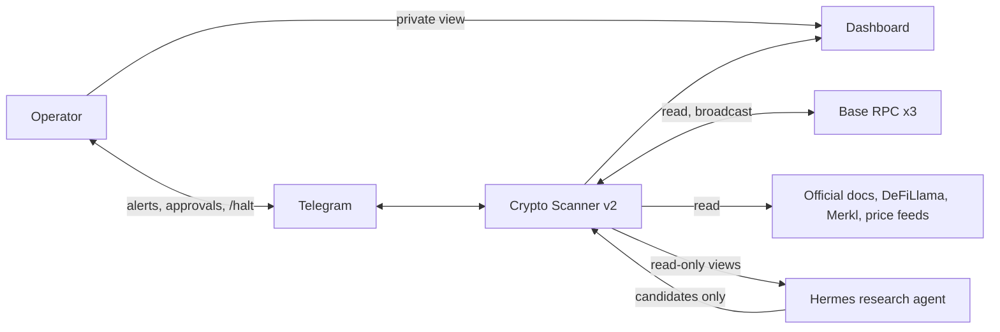
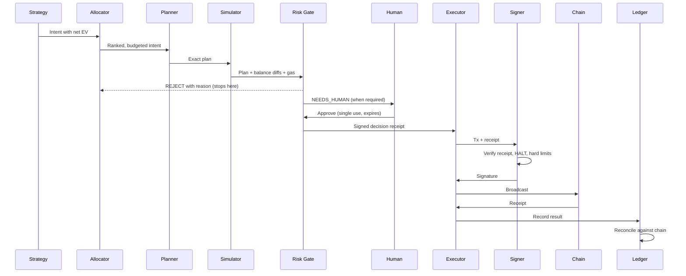
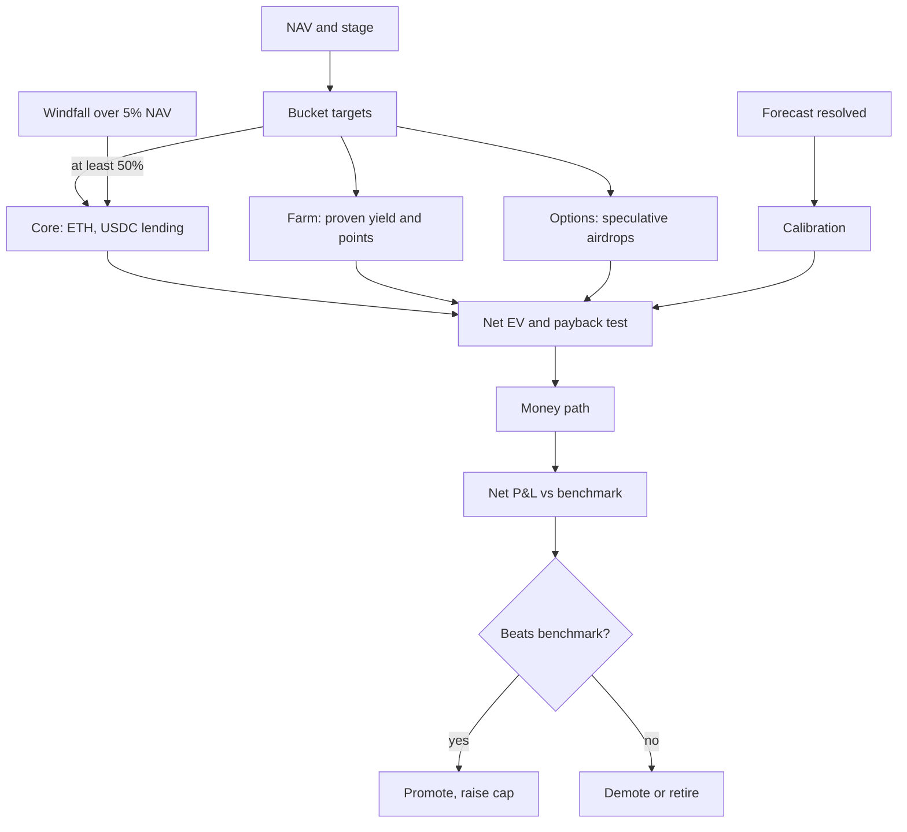

# 05 — HLD: High-Level Design

*Diseño de Alto Nivel*

## 1. System context

## 2. Components

| # | Component | Responsibility | Never does |
|---|---|---|---|
| 1 | **Scheduler** | Runs jobs, records outcomes | Business logic |
| 2 | **Indexer** | Pulls transactions, transfers and position events; emits events | Decide |
| 3 | **Market Data** | Prices and gas with multi-source checks | Serve stale values silently |
| 4 | **Ledger** | Append-only events, double-entry postings, NAV | Accept unbalanced entries |
| 5 | **Reconciler** | Compares ledger to chain; raises halt | Auto-correct a difference |
| 6 | **Registry** | Protocols, contracts, programs, evidence, code hashes | Trust unverified data |
| 7 | **Source Adapters** | Fetch from official and data sources | Execute fetched content |
| 8 | **Quarantine and Verifier** | Validates candidates deterministically | Promote without a human |
| 9 | **Strategies** | Turn state into intents | Touch keys or network |
| 10 | **Allocator** | Rank by net EV; apply budgets and buckets | Bypass Risk Gate |
| 11 | **Planner** | Turn intents into exact calldata from registry ABIs | Accept addresses from strategies |
| 12 | **Simulator** | Fork-simulate, extract balance diffs | Touch mainnet state |
| 13 | **Risk Gate** | Run all rules; issue receipts | Be bypassed or edited by agents |
| 14 | **Approvals** | Route to human as required; expire stale requests | Auto-approve above limits |
| 15 | **Executor** | Nonce, gas, broadcast, confirmation | Hold keys |
| 16 | **Signer** | Verifies receipt, re-checks limits, signs | Reach the network |
| 17 | **Forecasts** | Stores predictions; scores calibration | Change after creation |
| 18 | **Scorecards and Lifecycle** | Strategy performance and promotion | Promote past G3 without a human |
| 19 | **Auditor** | Independent recomputation, canaries | Approve or sign |
| 20 | **Surface** | Dashboard, reports, Telegram | Hold business logic |

## 3. Money path

Every transaction takes this route. There is no second one.

## 4. Earning engine

### Strategy catalogue

| Strategy | Bucket | Min stage | Earns from | Benchmark |
|---|---|---|---|---|
| `core-hold` | Core | S0 | Asset appreciation | ETH or USDC held |
| `usdc-park` | Core | S0 | Lending interest, points | Base USDC rate |
| `claim-watch` | Options | S0 | Airdrops already earned | None, costs only |
| `position-passive` | Options | S0 | Airdrop options, within budget | Budget burn |
| `cl-lp-managed` | Farm | S1 (paper in S0) | Trading fees, emissions | Hold 50/50 and base rate |
| `incentive-harvest` | Farm | S1 | Merkl and gauge rewards | Core return |
| `points-capital` | Farm | S1 | Capital-weighted points | Core return minus points value |
| `pt-yt` | Farm | S2 | Fixed yield or points leverage | Base rate |
| `carry` | Farm | S2 | Funding spread | Base rate |

**Retired at cutover:** Limitless momentum, new-pool sniping, NFT flips, MEV, flash loans, quest grinding, per-airdrop burners.

## 5. Job schedule

Cadence follows how fast the data changes, instead of v1's single 30-minute loop.

| Job | S0 | S1 | Trigger type |
|---|---|---|---|
| Indexer | 5 min | 1 min | Timer |
| Gas and price | 5 min | 1 min | Timer |
| Position guard | 15 min | 1 min | Timer |
| Reconcile | 15 min and after each tx | 5 min and after each tx | Timer, event |
| Code hash check | 1 hour | 15 min | Timer |
| Claim watcher | 6 hours | 1 hour | Timer |
| Strategy and allocator | 1 hour | 15 min | Timer, state change |
| Source adapters | Daily | 6 hours | Timer |
| LLM research | Only on changed content | Same | Event |
| Auditor | 1 hour | 15 min | Timer |
| Canary suite | Daily | Daily | Timer |
| Forecast resolve | Daily | Daily | Timer |
| Weekly report | Sunday | Sunday | Timer |

## 6. Trust boundaries and data access

| Actor | Database | Keys | Network | Can halt |
|---|---|---|---|---|
| Core app | Read/write | None | Allowlisted hosts | Yes |
| Signer | None | Yes | None | Obeys |
| Auditor | Read core, write own | None | Own RPC path | Yes |
| Hermes / LLM | Export only | None | Open | No |
| Surface | Read views | None | Telegram, dashboard host | Yes, on operator command |

## 7. Failure behaviour

| Failure | Behaviour |
|---|---|
| Host down | Positions stay; catch up on restart; no replays |
| RPC disagreement | No money decisions; reads continue |
| Stale price or gas | Risk Gate rejects |
| Reconciliation breach | Global halt until reviewed |
| Unattributed transaction | Global halt, security alert |
| Contract code changed | Halt that protocol; alert |
| Simulation unavailable | Reject |
| LLM down | Research pauses; nothing else notices |
| Telegram down | Approvals expire; auto-actions continue within limits; halt still works locally |
| Halt set | Signer refuses everything; read paths continue |

## 8. Operator experience

- **Weekly:** one Telegram report: NAV versus plan, net P&L, costs, what was retired.
- **As needed:** approval cards stating action, amount, contract name, gas, simulated result and expiry.
- **Emergency:** `/halt` from Telegram, or a local command.
- **Dashboard:** NAV, buckets, strategies against benchmarks, open forecasts, SLO status, each value with its age.
